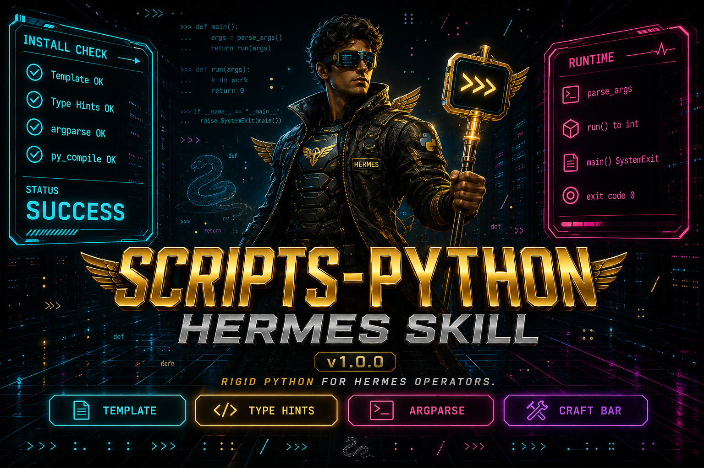

# scripts-python

[](https://github.com/NousResearch/hermes-agent)
[](LICENSE)

**Version 1.0.0** — house style for long-lived Python scripts and tools.



## What is in this repo

| File | What it is |
|------|------------|
| `skills/software-development/scripts-python/SKILL.md` | The rules. 139 lines, `version: 1.0.0` in frontmatter. |
| `.../templates/template_base.py` | The one skeleton. 65 lines, 3 functions. |
| `.../references/python-conventions.md` | Naming and style law. |
| `.../references/authoring.md` | How to apply the rules. |
| `SECURITY.md` | How to report issues, plus Python failure modes this skill treats as security-relevant. |
| `docs/assets/scripts-python-hero.png` | 1536 × 1024 image above. |

The skill ships **one** template. There is no second copy and no `examples/` directory. CI fails the build if either reappears.

```text
skills/software-development/scripts-python/
  SKILL.md
  templates/template_base.py
  references/python-conventions.md
  references/authoring.md
```

This repo is the skill. It does not contain production tools.

## Install

```bash
git clone https://github.com/Unix-Dev-Ops/scripts-python.git
mkdir -p ~/.hermes/skills/software-development
cp -a scripts-python/skills/software-development/scripts-python \
  ~/.hermes/skills/software-development/
```

That lands at `~/.hermes/skills/software-development/scripts-python/`. Load it by name (`scripts-python`). Do not also copy it into a Hermes profile — a second copy stops tracking this tree the day either one is edited.

## What the skeleton does

`templates/template_base.py` defines three functions. Reuse them; do not rewrite them:

`parse_args` `run` `main`

`parse_args()` uses `argparse`. `run(args)` returns an exit code. `main()` catches `KeyboardInterrupt` and returns 1. The file ends with `raise SystemExit(main())`.

## Verify

CI on `main` and pull requests runs `python3 -m py_compile` and `ruff check` against `templates/template_base.py`, and asserts there is no `examples/` directory.

## Contributing

PRs are reviewed by the maintainer in [CODEOWNERS](.github/CODEOWNERS).

- **Scope** — rules, one template, the conventions, and how-to docs. No host-specific production tools, no secrets.
- **One concern per change** — "fix the header alignment rule", not "rewrite everything".
- **Style is not optional** — match `SKILL.md` and the template.

## Security

See [SECURITY.md](SECURITY.md).

## Author

**Vituvo** ([@Unix-Dev-Ops](https://github.com/Unix-Dev-Ops))

## License

[MIT](LICENSE) — Copyright (c) 2026 Vituvo
